<div align="center">
  <a href="https://aral3000.github.io">
    
  </a>
</div>

<br/>

<p align="center">
  <a href="https://aral3000.github.io"></a>
  <a href="https://linkedin.com/in/mathallahrafifaldera"></a>
  <a href="https://www.credly.com/users/m-athallah-rafif-aldera/badges/credly"></a>
  <a href="mailto:mathallahrafifaldera@gmail.com"></a>
</p>

```python
aral@workstation:~$ neofetch --profile
  /\_/\   (o.o)   [M. Athallah Rafif Aldera, S.Kom.]
 ( > < )  ( _ )   AI & Machine Learning Engineer
───────────────────────────────────────────────────────────────────
▸ Degree       : B.S. in Computer Systems, Sriwijaya University (GPA 3.77/4.00)
▸ Focus        : Computer Vision, Generative AI (GANs) & Data Science
▸ Flagship     : StyleGAN2-ADA (FID 49.62) & DenseNet121 (Acc 97.00% / 95.00% Synth)
▸ Defense ML   : Phishing URL Guard on 630K URLs (Acc 89.0%, KOMINFO)
▸ Stack        : Python 3, PyTorch, TensorFlow, Scikit-Learn, FastAPI, SQL
▸ Availability : Open for AI / Data / Software Roles (Jakarta / Hybrid / Remote)
───────────────────────────────────────────────────────────────────
```

---

### 🚀 About Me

* 🎓 **Fresh Graduate in Computer Systems (S.Kom., GPA 3.77/4.00)** from **Universitas Sriwijaya (UNSRI)**, specializing in AI Engineering, Computer Vision, and Data Science.
* 🔬 **Medical AI & Generative Modeling**: Benchmarked **StyleGAN2-ADA**, **StyleGAN3**, and **DCGAN** on clinical VIA cervical datasets; achieved a peak FID score of **49.62**, elevated **DenseNet121** accuracy to **97.00%** (50% real + 50% synthetic augmentation), and demonstrated 100% synthetic substitution with **95.00% test accuracy**, **96% F1-score**, and **100.00% positive precision & specificity**.
* 🛡️ **Applied Machine Learning & Cybersecurity**: Developed a phishing link detection pipeline for **Dinas Kominfo** on a **630,071 URL dataset** using Random Forest, achieving **89.0% testing accuracy** with an interactive Streamlit UI and FastAPI service.
* 🤖 **Agentic AI & Core Engineering**: Building autonomous ReAct agent workflows with Tool Calling, Cosine Vector Stores, and Test-Driven Development (TDD) Python data pipelines.
* ☁️ **Verified Credentials**: **Komdigi Digital Talent Scholarship (AI)**, **ASEAN Foundation & Google.org (AI Career Readiness)**, **Google Cloud Skill Badges** ([Credly Profile](https://www.credly.com/users/m-athallah-rafif-aldera/badges/credly)), and **6 Dicoding Indonesia Competency Certificates** (Machine Learning, Python, Data Science, SQL, AI, Data Visualization).

---

### 🌟 Featured Repositories

| Project | Focus | Tech Stack | Highlights |
| :--- | :--- | :--- | :--- |
| [**cervical-cancer-stylegan2-densenet121**](https://github.com/aral3000/cervical-cancer-stylegan2-densenet121) | Medical AI & Computer Vision | `PyTorch`, `StyleGAN2-ADA`, `DenseNet121`, `CUDA` | Synthesized clinical images; peak FID of **49.62** on StyleGAN2-ADA; **97.00% peak accuracy** (50:50 mix) & **95.00% accuracy** with 100% synthetic substitution (`100%` positive precision). |
| [**phishing-detection-system**](https://github.com/aral3000/phishing-detection-system) | Applied ML & Cybersecurity | `Python`, `Scikit-Learn`, `Streamlit`, `FastAPI` | Public sector ML system trained on **630,071 URLs** achieving **89.0% testing accuracy**; features 9 lexical URL extractors, interactive UI & REST API. |
| [**python-ai-core-toolkit**](https://github.com/aral3000/python-ai-core-toolkit) | Data Engineering & Algorithms | `Python 3`, `NumPy`, `Pandas`, `pytest` | Modular TDD toolkit implementing $O(1)$ data structures, vectorized NumPy similarity matrices, and Pandas feature engineering pipelines. |
| [**autonomous-market-research-agent**](https://github.com/aral3000/autonomous-market-research-agent) | Agentic AI & Production LLM | `FastAPI`, `Streamlit`, `Vector DB`, `ReAct` | Autonomous market research agent executing search & scraping tools, maintaining long-term memory in a Cosine Vector Store, and generating executive reports. |

---

### 🛠️ Tech Stack & Tooling

<p align="left">
  <!-- Languages -->
  
  
  
  
  <br/>
  <!-- AI / ML Frameworks -->
  
  
  
  
  <br/>
  <!-- Data & Visualization -->
  
  
  
  
  <br/>
  <!-- Cloud & DevOps -->
  
  
  
</p>

---

### 📊 GitHub Activity & Statistics

<p align="center">
  
  
</p>

---

<p align="center">
  <i>"Relentlessly pursuing technical excellence and building verified, production-ready intelligent systems."</i><br/>
  <b>Let's connect and build something extraordinary!</b>
</p>
